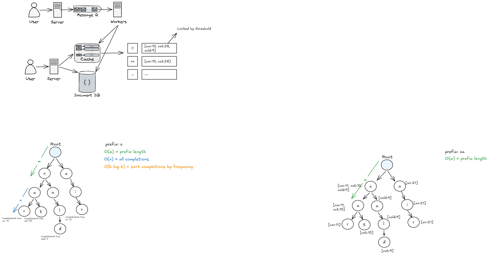

# High-Concurrency Prefix Search Service (Autocomplete API)

A high-performance, low-latency autocomplete search engine designed to provide real-time suggestions based on user input and historical search volume. This project implements a distributed architecture to handle high concurrency, leveraging an optimized in-memory data structure alongside asynchronous background processing.

## 🚀 Architecture & System Design


A high-performance, low-latency autocomplete search engine designed to provide real-time suggestions based on user input and historical search volume. This project implements a distributed architecture to handle high concurrency, leveraging an optimized in-memory data structure alongside asynchronous background processing.

## 🚀 Architecture & System Design



The architecture evolved through several optimization phases to minimize latency and handle scale:

### 1. Data Structure Optimization
*   **Initial Approach:** The core engine relies on a **Trie** data structure to store words character by character[cite: 3]. The initial time complexity was $O(M + N + k \log k)$, where $O(M)$ is the prefix length, $O(N)$ is traversing all completions, and $O(k \log k)$ is sorting completions by frequency[cite: 3].
*   **Pre-computation:** To eliminate the real-time sorting bottleneck, the Trie was optimized to store pre-computed top completions directly at each node[cite: 3]. This reduced the lookup time complexity to $O(M)$[cite: 3].

### 2. Distributed Caching & Storage
*   **$O(1)$ Search Latency:** The system caches the pre-computed top suggestions in **Redis (Sorted Sets)**, reducing the read latency from logarithmic time down to $O(1)$[cite: 3]. The number of cached suggestions is limited by a configurable threshold[cite: 3].
*   **Persistent Storage:** A Document DB (MongoDB) is used as the permanent source of truth for all search terms and their cumulative scores[cite: 3].

### 3. Asynchronous Processing
*   **Event-Driven Updates:** To prevent search requests from being blocked by database writes, the primary server forwards user search events to a Message Queue (Apache Kafka)[cite: 3].
*   **Background Workers:** Dedicated worker services consume these messages from the queue and asynchronously update both the Document DB and the Cache[cite: 3].

## 💻 Tech Stack

*   **Backend API:** Java, Spring Boot
*   **Worker Service:** Java, Spring Boot, Apache Kafka Streams
*   **Frontend:** React (Vite)
*   **Database:** MongoDB
*   **Cache:** Redis
*   **Infrastructure:** Docker & Docker Compose

## 📁 Repository Structure

This project is organized as a monorepo containing the frontend, backend API, and worker services:

```text
search-engine/
├── search-engine-fe/        # React/Vite frontend UI
├── search-engine-be/        # Spring Boot REST API for client requests
├── search-engine-worker/    # Spring Boot Kafka consumers for async processing
├── docker-compose.yaml      # Multi-container orchestration
└── .gitignore               # Root ignore rules)

The architecture evolved through several optimization phases to minimize latency and handle scale:

### 1. Data Structure Optimization
*   **Initial Approach:** The core engine relies on a **Trie** data structure to store words character by character[cite: 3]. The initial time complexity was $O(M + N + k \log k)$, where $O(M)$ is the prefix length, $O(N)$ is traversing all completions, and $O(k \log k)$ is sorting completions by frequency[cite: 3].
*   **Pre-computation:** To eliminate the real-time sorting bottleneck, the Trie was optimized to store pre-computed top completions directly at each node[cite: 3]. This reduced the lookup time complexity to $O(M)$[cite: 3].

### 2. Distributed Caching & Storage
*   **$O(1)$ Search Latency:** The system caches the pre-computed top suggestions in **Redis (Sorted Sets)**, reducing the read latency from logarithmic time down to $O(1)$[cite: 3]. The number of cached suggestions is limited by a configurable threshold[cite: 3].
*   **Persistent Storage:** A Document DB (MongoDB) is used as the permanent source of truth for all search terms and their cumulative scores[cite: 3].

### 3. Asynchronous Processing
*   **Event-Driven Updates:** To prevent search requests from being blocked by database writes, the primary server forwards user search events to a Message Queue (Apache Kafka)[cite: 3].
*   **Background Workers:** Dedicated worker services consume these messages from the queue and asynchronously update both the Document DB and the Cache[cite: 3].

## 💻 Tech Stack

*   **Backend API:** Java, Spring Boot
*   **Worker Service:** Java, Spring Boot, Apache Kafka Streams
*   **Frontend:** React (Vite)
*   **Database:** MongoDB
*   **Cache:** Redis
*   **Infrastructure:** Docker & Docker Compose

## 📁 Repository Structure

This project is organized as a monorepo containing the frontend, backend API, and worker services:

```text
search-engine/
├── search-engine-fe/        # React/Vite frontend UI
├── search-engine-be/        # Spring Boot REST API for client requests
├── search-engine-worker/    # Spring Boot Kafka consumers for async processing
├── docker-compose.yaml      # Multi-container orchestration
└── .gitignore               # Root ignore rules
